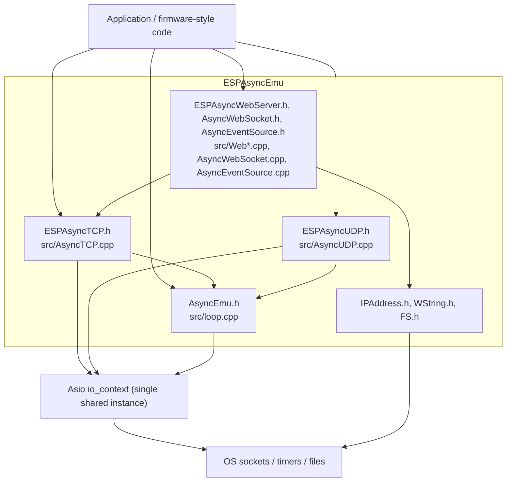
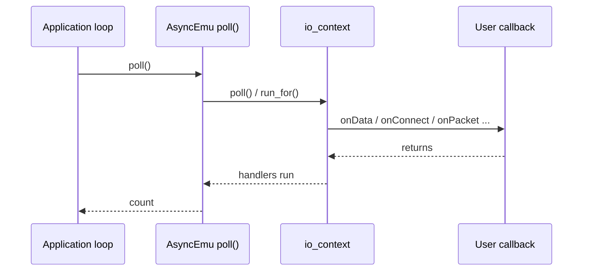
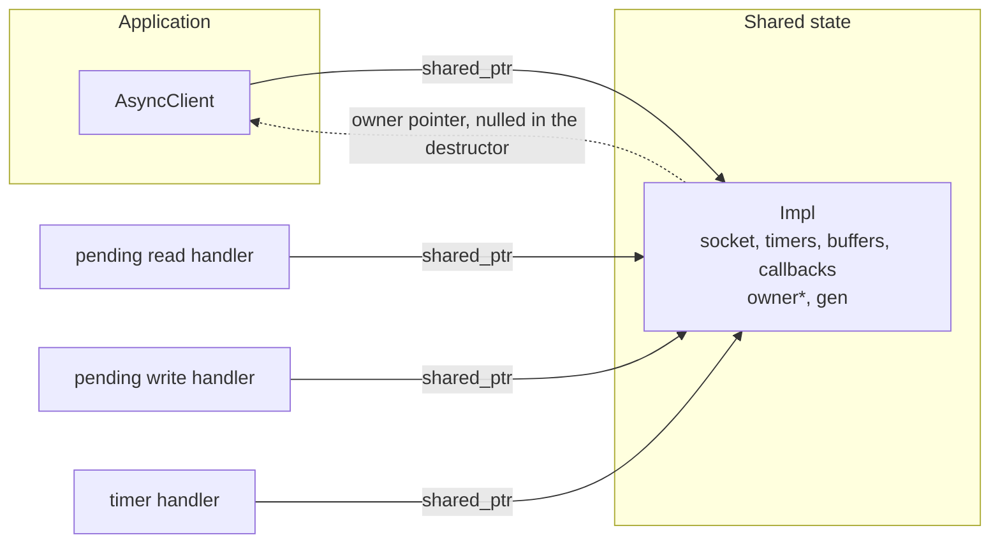

# Architecture

## Layers

The web layer is built on `AsyncServer` / `AsyncClient` rather than on Asio directly, just as the real ESPAsyncWebServer sits on AsyncTCP; see [ESPAsyncWebServer](ESPAsyncWebServer.md).

Public headers live in `include/` and never expose Asio types. Asio is a private dependency of the static library, so applications only see the Arduino-style API.

## Threading model

Everything is **single threaded and caller-driven**. There is exactly one `asio::io_context` (concurrency hint 1). Nothing happens on the network until the application calls `AsyncEmu::poll()` / `pollFor()` / `run()`; every callback then runs inside that call, on the caller's thread. User code never needs locks, which mirrors the cooperative model of the real ESP libraries.

## Object lifetime

On the device, applications routinely `delete` an `AsyncClient` from inside one of its own callbacks (usually `onDisconnect`). With Asio, handlers may still be queued for that object, so each networking object is split in two:

- the **public object** (`AsyncClient`, `AsyncServer`, `AsyncUDP`) that the application owns, and
- a hidden **`Impl`** held by `std::shared_ptr`, which pending Asio handlers also hold.

Two rules make this safe:

1. **`owner` pointer.** `~AsyncClient` sets `Impl::owner = nullptr` and closes the socket silently. After every callback, the code re-checks `owner` before touching anything else.
2. **Generation counter (`gen`).** Every teardown increments `gen`. Handlers capture the value at creation and return immediately if it changed. This prevents stale completions (for example data that arrived just before `close()` + `connect()` on the same object) from being delivered.

Callbacks are *copied* before being invoked, so a callback that re-registers itself (`onData(...)` inside `onData`) does not destroy the running `std::function`.

`AsyncServer` hands out heap-allocated clients exactly like the real library; the application owns them.

The web layer repeats the idea one level up: the server owns an `AsyncWebServerRequest` per connection and deletes it when the client disconnects. WebSocket and event-stream clients *take over* the connection from the request (see [Realtime](Realtime.md#from-http-request-to-long-lived-connection)).

## Device limits

Every user callback is invoked inside a small scope object (`CallbackScope`, `src/AsyncEmuInternal.h`). It tracks "inside a callback" and times the outermost callback, which is how the [watchdog](Device-Profiles.md#watchdog) and the `delay()` warning work. The other limits are read where they apply: the send buffer in `AsyncClient::space()`, the connection cap in `AsyncServer`'s accept path, and strict headers and the form body limit in the web request parser.

## Source map

| File | Purpose |
|------|---------|
| `include/AsyncEmu.h`, `src/loop.cpp` | Event loop control |
| `include/ESPAsyncTCP.h`, `src/AsyncTCP.cpp` | `AsyncClient`, `AsyncServer` |
| `include/ESPAsyncUDP.h`, `src/AsyncUDP.cpp` | `AsyncUDP`, `AsyncUDPPacket`, `AsyncUDPMessage` |
| `include/ESPAsyncWebServer.h`, `src/Web*.cpp` | `AsyncWebServer`, requests, responses, handlers |
| `include/AsyncWebSocket.h`, `src/AsyncWebSocket.cpp` | WebSocket |
| `include/AsyncEventSource.h`, `src/AsyncEventSource.cpp` | Server-Sent Events |
| `include/AsyncJson.h` | JSON responses and request handler (header only, needs ArduinoJson) |
| `include/IPAddress.h`, `include/WString.h`, `include/Print.h`, `include/Stream.h`, `include/Arduino.h`, `include/FS.h`, `src/FS.cpp` | Arduino-style IPv4 address, `String`, `Print`/`Stream`, Arduino core shim, file system ([Arduino-Compat](Arduino-Compat.md)) |
| `src/AsyncEmuInternal.h` | Shared `io_context` accessor, IPAddress/Asio conversions |
| `cmake/FetchAsio.cmake` | Fetches standalone Asio 1.30.2 |
