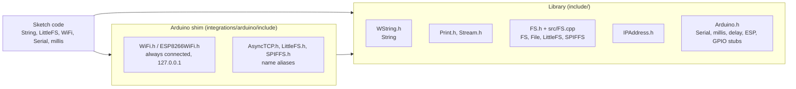

# Arduino compatibility layers

Real ESP sketches use Arduino's `String`, `FS`/`LittleFS` and `WiFi`. So that unmodified code builds on the desktop, the project ships small stand-ins.



The first group (`String`, `Print`, `Stream`, `FS`, `IPAddress`, and `Arduino.h` itself) is part of the main library because the web server and JSON APIs use them. The `WiFi` stub and name aliases are only needed to run whole sketches and live with the [Arduino runner](Integrations.md#arduino-sketch-runner-integrationsarduino).

## String

`include/WString.h`: `class String : public std::string`, so it converts freely to and from `std::string` while offering the Arduino API.

| Area | Methods |
|------|---------|
| Building | constructors from `const char*`, `std::string`, `char`, ints (with base), floats (decimals); `+`, `+=`, `concat` |
| Searching | `startsWith`, `endsWith`, `indexOf`, `lastIndexOf`, `charAt`, `substring` |
| Editing | `replace`, `remove`, `trim`, `toLowerCase`, `toUpperCase`, `setCharAt` |
| Comparing | `equals`, `equalsIgnoreCase`, `==`, `<` (inherited) |
| Converting | `toInt`, `toFloat`, `toDouble` |

`append()` returns `String&` (needed so ArduinoJson treats it as a string destination; see [Json](Json.md)).

Numbers append their **text**, like Arduino: `String("n=") + 5` is `"n=5"`, `+ 2.5` gives `"n=2.50"`. Only a `char` appends the character itself. (An early version of this class silently turned `String + int` into a raw byte; there is now a regression test.)

`F()`, `PSTR()`, `FPSTR()` and `PROGMEM` are defined as no-ops.

## Print, Stream and Printable

`include/Print.h`, `include/Stream.h`: the Arduino base classes. `Print` provides `print`, `println`, `printf` and `write`; you implement `write(uint8_t)`. `println` ends lines with `"\r\n"` like Arduino. `Stream` adds `available`, `read`, `peek`, `readBytes`, `readString`, `readStringUntil`.

| Type | Is a |
|------|------|
| `AsyncResponseStream` | `Print` |
| `File` | `Stream` (so `Print` too) |
| `Serial` | `Stream` (writes to stdout, drops `'\r'`, flushes at each newline) |

This is what lets `serializeJson(doc, *response)`, `serializeJson(doc, file)` and `deserializeJson(doc, file)` work unchanged.

## File system

`include/FS.h`, `src/FS.cpp`. `fs::FS` is backed by a directory on the host; the globals `LittleFS` and `SPIFFS` are two instances.

```cpp
LittleFS.setRoot("./data");   // emulation extension: host directory that backs "/"
LittleFS.begin();             // creates it if missing
File f = LittleFS.open("/config.txt", "w");
f.println("hello");
f.close();
```

| Item | Notes |
|------|-------|
| Default roots | `./littlefs` and `./spiffs` relative to the working directory |
| `open(path, mode)` | `"r"`, `"w"` (creates parent directories, like the device), `"a"`, `"r+"`, `"w+"`; directories open with `"r"` |
| `File` | `read`, `write`, `print`, `println`, `seek`, `position`, `size`, `available`, `peek`, `readString`, `close`, `isDirectory`, `openNextFile`, `name`, `path`, `getLastWrite`; copyable (shared handle) |
| `FS` | `exists`, `remove`, `rename`, `mkdir`, `rmdir`, `format`, `begin`, `end` |
| **Sandbox** | any path containing a `..` component is rejected (`open` returns an invalid `File`, `exists` is false, `remove` fails) so neither sketch bugs nor uploaded filenames can reach files outside the root |

Construct your own with `FS myFs("/some/host/dir")`.

## Arduino core shim

`include/Arduino.h` (part of the core library; include it where you want an Arduino-like environment):

- `millis()`, `micros()`, `delay()` (which keeps the network pumping), `yield()`
- `Serial` (a `Stream`): `begin`, `print`, `println`, `printf`, `flush` writing to stdout, flushed per line so logs appear when piped
- `pinMode`, `digitalWrite` (prints `[gpio] pin N -> HIGH`), `digitalRead`, `analogRead` stubs
- `ESP.getFreeHeap()`, `ESP.getChipId()`, `ESP.restart()` (exits)

`WiFi.h` / `ESP8266WiFi.h` / `WiFiClient.h`: `WiFi.begin()` "connects" at once; `WiFi.status()` is always `WL_CONNECTED`; `WiFi.localIP()` is `127.0.0.1`. Name aliases: `AsyncTCP.h` (the ESP32 name of ESPAsyncTCP.h), `LittleFS.h`, `SPIFFS.h`.

## Privileged ports

Sketches often use `AsyncWebServer server(80)`. A desktop process usually isn't allowed to bind ports below 1024, so:

```cpp
AsyncEmu::setPortOffset(8000);   // listening ports below 1024 get +8000: 80 -> 8080
```

or set `ESPASYNCEMU_PORT_OFFSET=8000` in the environment, or pass `--port-offset 8000` to the sketch runner. It applies to `AsyncServer` / `AsyncWebServer` and `AsyncUDP::listen`; ports 1024 and above are never shifted, and `server.port()` / `udp.localPort()` report the actual port.
