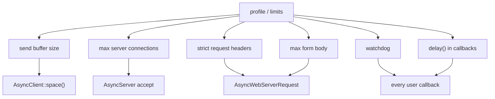
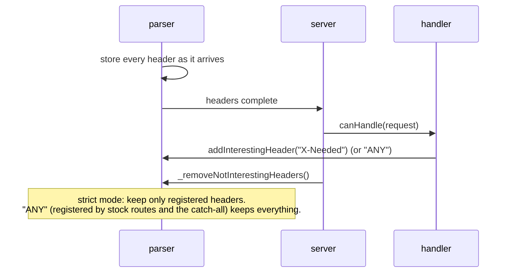

# Device profiles (strict mode)

A desktop is far more generous than an ESP: a huge send buffer, unlimited connections, no watchdog, every header kept. Code can look fine on the desktop and then misbehave on the board. **Device limits** run the same code under constraints that resemble the real chips, so those problems appear while you are still at your desk.

Everything is off by default (the `desktop` profile). Declared in `AsyncEmu.h`, implemented in `src/loop.cpp`.



## Choosing a profile

| How | Example |
|-----|---------|
| Environment variable | `ESPASYNCEMU_PROFILE=esp8266 ./my_app` |
| Arduino runner | `./web_sketch --profile esp32` |
| Code | `AsyncEmu::setDeviceProfile("esp8266");` |
| Custom | `auto l = AsyncEmu::deviceLimits(); l.maxConnections = 3; AsyncEmu::setDeviceLimits(l);` |

| Profile | Send buffer | Max connections | Strict headers | Max form body | Watchdog | `delay()` warning |
|---------|-------------|-----------------|----------------|---------------|----------|-------------------|
| `desktop` (default) | 5744 B | unlimited | no | 1 MB | off | no |
| `esp8266` | 1072 B (2 x MSS 536, lwIP "lower memory") | 5 | yes | 4 KB | 3000 ms | yes |
| `esp8266-hb` | 2920 B (2 x MSS 1460, lwIP "higher bandwidth") | 5 | yes | 4 KB | 3000 ms | yes |
| `esp32` | 5744 B | 16 | yes | 32 KB | 5000 ms | yes |

These are approximations of common default configurations, not measurements of a particular board: tune them with `setDeviceLimits()` to match yours.

## What each limit does

### Send buffer size
`AsyncClient::space()` and everything built on it (response streaming, WebSocket and SSE queues) use this size. With 1072 bytes a 50 KB response needs about 50 ack-driven steps instead of 9, which flushes out code that assumed a `write()` always accepts everything.

### Connection cap
When the number of connections **accepted by AsyncServer(s)** reaches the limit, further connections are accepted by the OS and immediately closed, as when the TCP control block table is full. A warning explains why. (Connections made by `AsyncClient::connect()` are not counted, which keeps in-process test clients out of the arithmetic.)

### Strict request headers

The stock handlers register what they need: callback routes and the catch-all register `ANY`, the static handler `If-None-Match` and `If-Modified-Since`, WebSocket `Sec-WebSocket-Version/Key/Protocol`, EventSource `Last-Event-ID`. A **custom `AsyncWebHandler`** that reads `request->header("X-Something")` without registering it works on the desktop but sees an empty string under strict mode, and on the device. Fix it in `canHandle`:

```cpp
bool canHandle(AsyncWebServerRequest* request) override {
    if (request->url() != "/mine") return false;
    request->addInterestingHeader("X-Something");
    return true;
}
```

### Form body limit
An `application/x-www-form-urlencoded` body larger than the limit is rejected with `413` (the body is buffered in RAM on the device).

### Watchdog
Every user callback (`onData`, `onClient`, `onPacket`, a `post()`ed function, ...) runs inside a *callback scope*. If the outermost callback takes longer than `watchdogMs` a warning is printed:

```
[ESPAsyncEmu] watchdog: a network callback ran for 3120 ms (limit 3000 ms). On the device this resets the chip: never block (delay(), long loops, slow I/O) inside callbacks.
```
Set `abortOnWatchdog = true` to `abort()` instead, like the chip resetting. Nested callbacks count towards the outermost one, so a `delay()` that pumps the loop from inside a callback is measured as blocking time.

### delay() inside a callback
The Arduino shim's `delay()` warns (once) when called while `AsyncEmu::inCallback()` is true. On the device this blocks the TCP task; the usual fix is to set a flag and do the work from `loop()`.

## Warnings

Diagnostics from the emulation (watchdog, refused connections, a full WebSocket or SSE queue dropping a message) go to stderr, prefixed `[ESPAsyncEmu]`. Install your own handler, e.g. in tests:

```cpp
AsyncEmu::setWarningHandler([&](const std::string& message) { warnings.push_back(message); });
```

## What is not modelled

Heap size and fragmentation, CPU speed, flash timing, WiFi behaviour, and the exact lwIP internals. Use a real board for performance and memory sign-off; use these limits to catch the *logic* mistakes early.

## How it is tested

`tests/limits_test.cpp` covers each limit. In addition CTest runs the whole **web**, **realtime** and **JSON** suites again under `esp8266`, `esp8266-hb` and `esp32` (via `ESPASYNCEMU_PROFILE`), so every response path is exercised with tiny send buffers, filtered headers and connection caps.
