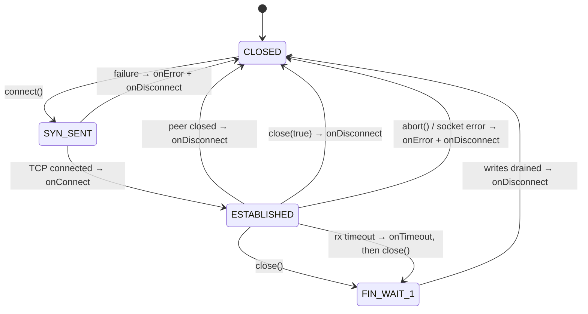
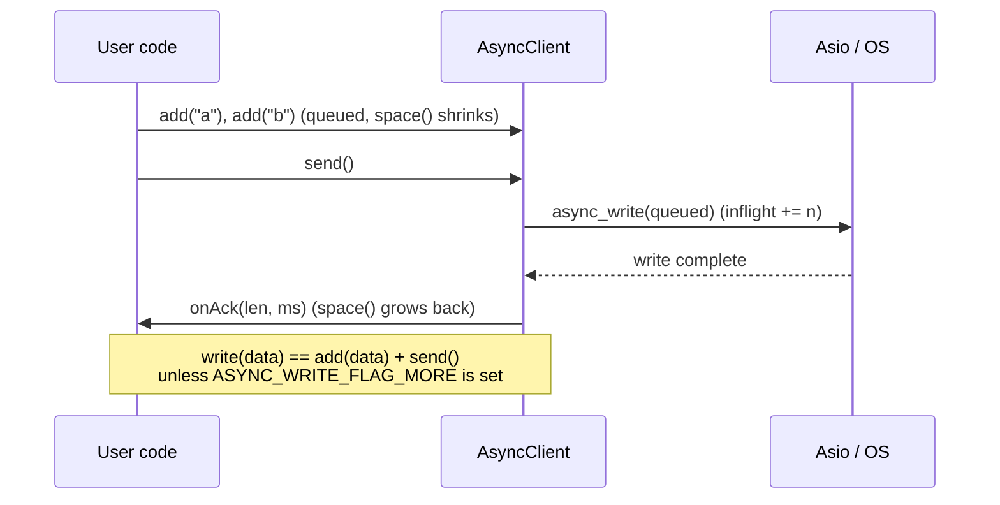
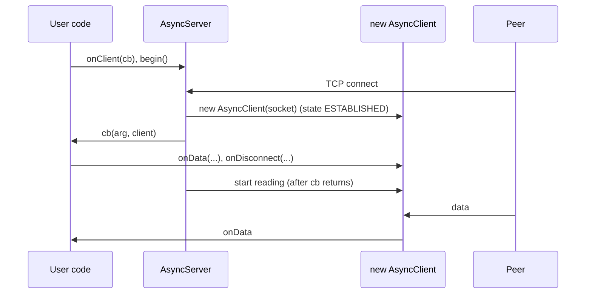

# ESPAsyncTCP

`include/ESPAsyncTCP.h`, `src/AsyncTCP.cpp`. Same public API as me-no-dev/ESPAsyncTCP, minus lwip-specific parts (`tcp_pcb`, `pbuf` packet handler). IPv4 only.

## AsyncClient

### Connection state machine

`state()` reports lwip state numbers. The emulation only passes through the states below; the FIN/CLOSING states are collapsed into `FIN_WAIT_1` while a graceful close drains.

Helper predicates: `connecting()` (1–3), `connected()` (4), `disconnecting()` (5–9), `disconnected()` (0 or 10).

### Callbacks

| Registration | Signature | Fires |
|--------------|-----------|-------|
| `onConnect` | `(void* arg, AsyncClient*)` | connection established (outgoing, and for accepted clients via the server's `onClient`) |
| `onDisconnect` | `(void*, AsyncClient*)` | connection gone, for any reason, exactly once |
| `onError` | `(void*, AsyncClient*, int8_t err)` | failed connect, reset, abort. Always followed by `onDisconnect` |
| `onData` | `(void*, AsyncClient*, void* data, size_t len)` | data received. `data` is only valid during the call |
| `onAck` | `(void*, AsyncClient*, size_t len, uint32_t ms)` | written data was handed to the OS; `ms` is the time it took |
| `onTimeout` | `(void*, AsyncClient*, uint32_t ms)` | no data for `setRxTimeout` seconds; the connection is closed afterwards |
| `onPoll` | `(void*, AsyncClient*)` | every ~500 ms while connected |

### Write path

`write()` copies into a send buffer of 5744 bytes (`space()` reports what is free). `send()` hands the buffered bytes to Asio; when Asio finishes, `onAck` fires and the space is released. This is what makes `space()`-driven flow control behave like the device.

### Graceful vs. immediate close

- `close()` / `stop()`: flushes queued data, waits for in-flight writes, shuts the socket down, then fires `onDisconnect`.
- `close(true)`: drops pending data and disconnects immediately (still `onDisconnect`, no `onError`).
- `abort()`: sends a TCP reset (linger 0), fires `onError(ERR_ABRT)` then `onDisconnect`, returns `ERR_ABRT`.

### Error codes

Numbering follows lwip 1.4. `errorToString(err)` gives the text.

| Name | Value | Typical cause in the emulation |
|------|-------|--------------------------------|
| `ERR_OK` | 0 | |
| `ERR_TIMEOUT` | -3 | OS-level connect timeout |
| `ERR_RTE` | -4 | host/network unreachable |
| `ERR_ABRT` | -8 | `abort()`, DNS failure, other socket errors |
| `ERR_RST` | -9 | connection refused / reset by peer |
| `ERR_CLSD` | -10 | broken pipe on write |

## AsyncServer

- Reading only starts **after** `onClient` returns, so handlers registered inside it never miss data.
- The application owns the `AsyncClient*` (typically `delete c` in `onDisconnect`). If the callback deletes the client immediately, the server notices and skips it.
- `AsyncServer(0)` binds a free port; `port()` (an extension, not in the real library) returns it after `begin()`.
- `begin()` sets `SO_REUSEADDR`. `end()` closes the listener; existing clients stay connected.

## Differences from the device library

- `AsyncClient(void* pcb)` ignores `pcb`.
- `ASYNC_WRITE_FLAG_COPY` is accepted but data is always copied.
- `setAckTimeout` is stored but unused.
- No `onPacket` / `pbuf` API.
- `AsyncServer::port()` is an addition.
