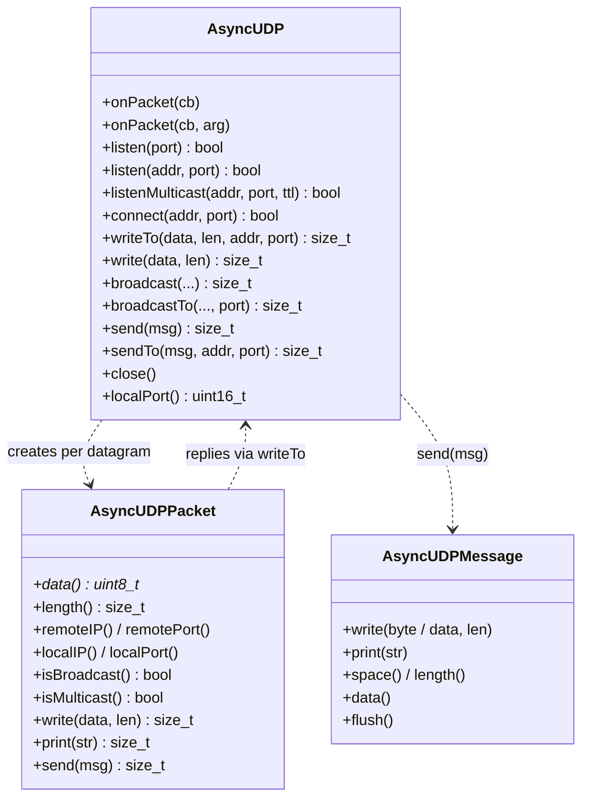
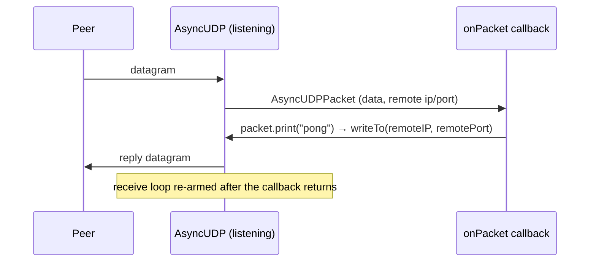

# ESPAsyncUDP

`include/ESPAsyncUDP.h`, `src/AsyncUDP.cpp`. IPv4 only.

## Classes

## Receive and reply flow

## Behaviour notes

- **Opening a socket.** `listen()` and `listenMulticast()` bind it; `connect()` sets a default peer for `write()`; `writeTo()` on an unopened socket opens it on an ephemeral port. Once a socket exists it keeps receiving, so replies to your own `writeTo()` arrive in `onPacket`.
- **`listen(0)`** picks a free port; read it back with `localPort()` (extension).
- **Datagram size.** The receive buffer is 64 KiB. `AsyncUDPMessage` defaults to 1460 bytes of capacity, like the device; `write` truncates at capacity and returns the number of bytes stored.
- **Return values.** Send functions return the byte count, or 0 on failure or when there is no default peer (`write()` before `connect()`).
- **Multicast.** `listenMulticast` joins the group, sets the TTL and enables `SO_REUSEPORT` on POSIX so several sockets can share the port.
- **Deleting in a callback** is safe, same mechanism as [TCP](Architecture.md#object-lifetime).
- **Port unreachable.** ICMP errors on connected sockets are ignored and receiving continues.

## Limitations

- `AsyncUDPPacket::isBroadcast()` is always `false`: the datagram's destination address isn't available through Asio's portable API.
- `AsyncUDPPacket::isMulticast()` is `true` for **every** packet received on a socket opened via `listenMulticast()`, including unicast ones sent to the same port.
- `AsyncUDPMessage` is not a `Print` subclass; it offers `write` and `print(const char*)` only.
- Broadcast/multicast delivery depends on the host's network setup and is not covered by the automated tests.
