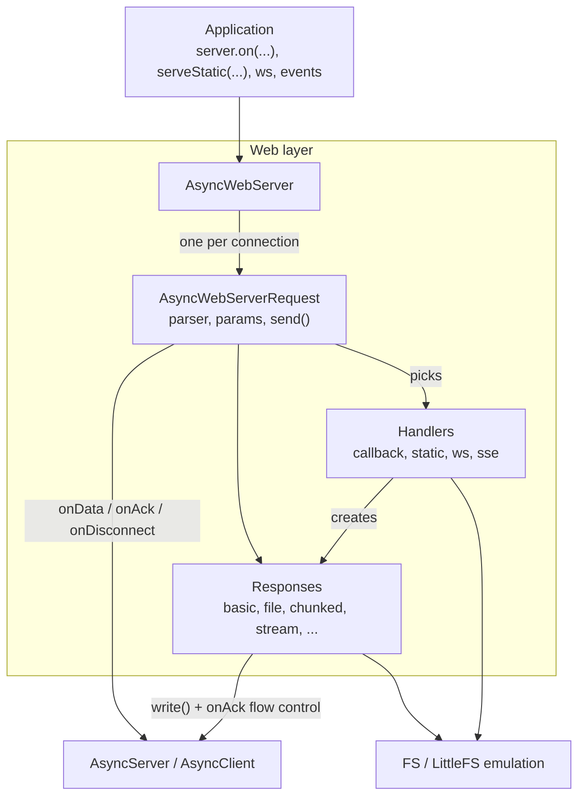
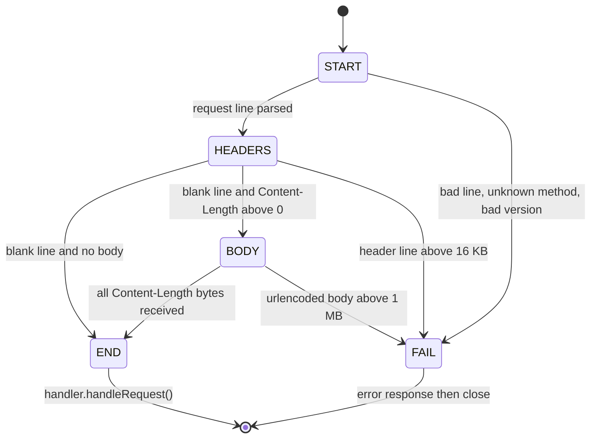
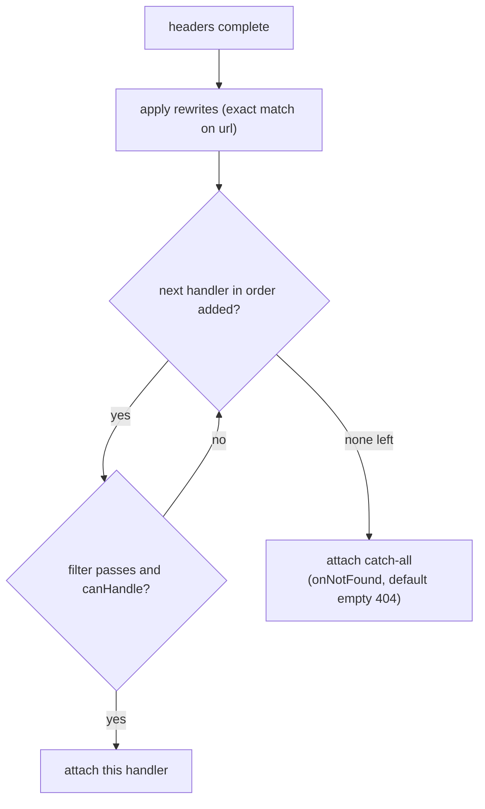
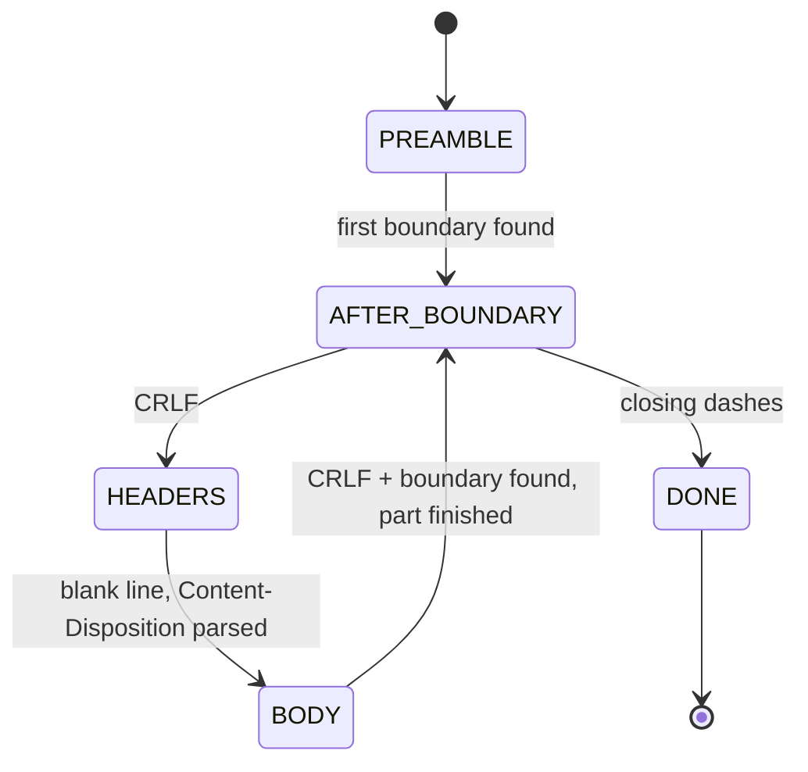
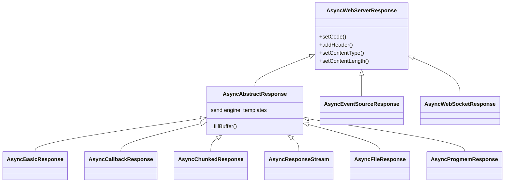
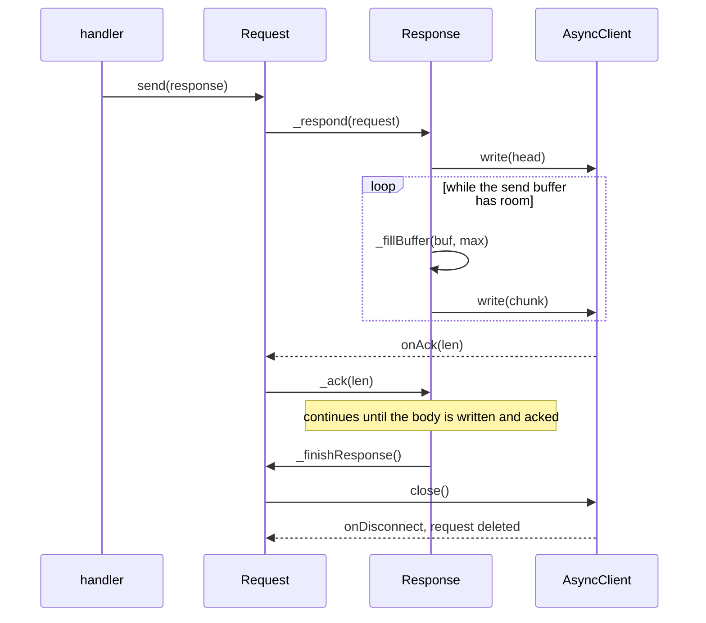
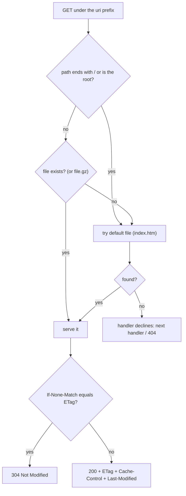

# ESPAsyncWebServer

`include/ESPAsyncWebServer.h`, with `src/WebRequest.cpp`, `src/WebResponse.cpp`, `src/WebServer.cpp`, `src/WebUtil.cpp`. A desktop emulation of me-no-dev/ESPAsyncWebServer with the same public API: routes, request and response objects, handlers, static files, uploads, authentication, rewrites and templates. WebSocket and Server-Sent Events are on their own page: [Realtime](Realtime.md).

It is built on this project's own [AsyncServer / AsyncClient](ESPAsyncTCP.md), exactly as the real library sits on AsyncTCP, so everything runs inside `AsyncEmu::poll()` on the caller's thread.



## Quick start

```cpp
#include "ESPAsyncWebServer.h"

AsyncWebServer server(8080);

int main() {
    server.on("/hello", HTTP_GET, [](AsyncWebServerRequest* request) {
        request->send(200, "text/plain", "Hello, " + request->arg("name"));
    });
    server.onNotFound([](AsyncWebServerRequest* request) { request->send(404); });
    server.begin();
    for (;;) AsyncEmu::pollFor(50);
}
```

`curl "http://127.0.0.1:8080/hello?name=Ada"` replies `Hello, Ada`. The full demo is [examples/web_server.cpp](Examples.md).

## Request lifecycle

The server creates one `AsyncWebServerRequest` per accepted connection. It parses incrementally as TCP data arrives, so a request may be spread over any number of segments.



Error responses sent while parsing: `400` bad request line, `501` unknown method, `505` unsupported HTTP version, `431` header too large, `413` form body too large.

Details that follow the real library:

- **One request per connection.** Every response has `Connection: close`, and the connection is closed once the response has been acknowledged. Pipelining and keep-alive are not supported.
- **`Expect: 100-continue`** is answered with `HTTP/1.1 100 Continue` once the headers are in (curl sends it for large uploads).
- **Idle timeout.** A request that has not been answered and sends nothing for 3 seconds is closed. The timeout is switched off as soon as a response starts. `server.setRequestTimeout(seconds)` changes it (an emulation extension).
- **Deferred responses.** A handler may keep the request pointer and call `send()` later (from a timer, `AsyncEmu::post`, etc.), as long as it stays within the idle timeout and the client hasn't gone. Use `request->onDisconnect(fn)` to learn that the request was destroyed.
- **Line endings.** Bare `LF` is accepted as well as `CRLF`; absolute-form request targets (`GET http://host/path`) are accepted.

## Routing

When the headers are complete the server applies rewrites and then looks for a handler:



`server.on(uri, [method,] onRequest [, onUpload [, onBody]])` matches, in this order:

| `uri` form | Matches |
|------------|---------|
| `"/path"` | exactly `/path`, **and** anything below it: `/path/more` (but not `/pathology`) |
| `"/path/*"` | any URL starting with `/path/` |
| `"^\\/user\\/([0-9]+)$"` | a regular expression (starts with `^`, ends with `$`); capture groups are read with `request->pathArg(i)` |
| `""` / not set | everything (this is what the catch-all uses) |

`method` is a bit mask: `HTTP_GET | HTTP_POST`, or `HTTP_ANY` (the default). A route that does not list `HTTP_HEAD` does not answer `HEAD`.

Handlers can be refined with `.setFilter(fn)` (`ON_STA_FILTER` is always true on the desktop, `ON_AP_FILTER` always false) and `.setAuthentication(user, password)`.

## Parameters and bodies

| What | Where it ends up |
|------|------------------|
| query string `?a=1&b=x%20y+z` | GET params (`isPost() == false`), percent-decoded, `+` becomes a space |
| `application/x-www-form-urlencoded` body | POST params (`isPost() == true`), buffered, up to 1 MB |
| `multipart/form-data` text fields | POST params |
| `multipart/form-data` file parts | file params (`isFile() == true`: `value()` is the filename, `size()` the byte count) and the **upload callback** |
| any other body (JSON, binary, ...) | the **body callback**, streamed in chunks |

```cpp
request->arg("x");                       // GET or POST value, "" if missing
request->hasParam("p", true);            // second argument: look at POST params
request->getParam("file", true, true);   // a file part
request->header("X-Custom");             // header value, case-insensitive name
```

Body callbacks receive `(request, data, len, index, total)`; upload callbacks receive `(request, filename, index, data, len, final)` and are called once per chunk with a final call (`final == true`, `len == 0`) at the end of each file.

### Multipart parsing

The parser streams through the body with a small state machine, never holding a whole file in memory. It keeps back the last few bytes of each chunk so a boundary split across TCP segments is still found.



Saving an upload (`request->_tempObject` carries the open file between chunks and is `free()`d with the request) is shown in [examples/web_server.cpp](Examples.md). Never trust `filename`: strip directories before using it. (The emulated `FS` refuses `..` anyway.)

## Responses



| Call | Response | Body length |
|------|----------|-------------|
| `send(code, type, text)` | `AsyncBasicResponse` | known (`Content-Length`) |
| `send(code)` | `AsyncBasicResponse` | none (`204`/`304` also omit `Content-Length`) |
| `send(FS, path, type, download, processor)` | `AsyncFileResponse` | file size; `.gz` files get `Content-Encoding: gzip`; `download` adds `Content-Disposition: attachment` |
| `send(type, len, filler)` | `AsyncCallbackResponse` | `len`, or unknown when `len == 0` |
| `sendChunked(type, filler)` | `AsyncChunkedResponse` | unknown |
| `beginResponseStream(type)` then `send(stream)` | `AsyncResponseStream` (`print`, `printf`, `write`) | unknown |
| `send_P(code, type, data, len)` | `AsyncProgmemResponse` | known |
| `redirect(url)` | `302` + `Location` | none |

**Unknown length** means `Transfer-Encoding: chunked` for HTTP/1.1 requests; for HTTP/1.0 the body simply ends when the connection closes. A *filler* is `size_t(uint8_t* buf, size_t maxLen, size_t index)`: return the bytes written, `0` to finish, or `RESPONSE_TRY_AGAIN` to be called again later (on the next ack or the 500 ms poll).

`DefaultHeaders::Instance().addHeader("Access-Control-Allow-Origin", "*")` adds a header to every response that doesn't already set it.

### How a response is sent

The engine writes only what fits in the client's send buffer (`space()`), then continues from `onAck`, so a large file never needs to be in memory:



### Template processing

Pass a processor to `send(FS/send_P/callback response, ...)` or `serveStatic(...).setTemplateProcessor(fn)`. `%NAME%` is replaced by `fn("NAME")`:

| Source text | Result |
|-------------|--------|
| `%NAME%` | whatever the processor returns (empty string for unknown names) |
| `%%` | a literal `%` |
| `100% sure` (a `%` not forming `%NAME%`, e.g. followed by spaces) | unchanged |
| a placeholder split across read chunks | handled; the engine holds back a possible partial placeholder |

Responses with a processor have unknown length (chunked). `serveStatic` only applies a processor to text-like files (`text/*`, JavaScript, JSON, XML, SVG): the real library also templates binaries, corrupting any `%...%` bytes.

## Static files

`server.serveStatic(uri, fs, path, cache_control)`:



- Options (chainable): `setDefaultFile("index.html")`, `setCacheControl("max-age=600")`, `setLastModified("<http date>")`, `setLastModified()` (use each file's mtime), `setTemplateProcessor(fn)`, `setAuthentication(u, p)`.
- ETag is `"<size hex>-<mtime hex>"`; `If-Modified-Since` is honoured when a fixed `Last-Modified` is configured.
- Content type comes from the file extension (`.html`, `.css`, `.js`, `.json`, `.png`, ... fallback `text/plain`).
- Only `GET` is served (not `HEAD`), as in the real library.
- Paths go through the sandboxed [FS emulation](Arduino-Compat.md#file-system), so `..` and `%2e%2e` cannot reach files outside the served directory.

## Authentication

```cpp
if (!request->authenticate("user", "pass"))              // Basic or Digest, whichever the client sent
    return request->requestAuthentication("My Realm", /*isDigest=*/false);   // Basic challenge
```

- `requestAuthentication(realm, isDigest = true)` sends a `401` with a Basic or Digest (`qop="auth"`, random nonce and opaque) challenge.
- `authenticate(user, pass, realm)` checks a Basic header, or recomputes the Digest response (MD5, `nc`, `cnonce`, `qop`). Digest is stateless: nonces are not remembered, as in the real library.
- `authenticate(hash)` compares `base64("user:pass")` with a Basic header.
- Per handler: `server.on(...).setAuthentication("user", "pass")`.
- Both schemes were verified against `curl --user` / `curl --digest`.

## Rewrites

`server.rewrite("/old", "/new?x=1")` changes the URL (and adds the query parameters) before handler lookup. Rewrites match the exact URL and take an optional `.setFilter(fn)`.

## Ownership

| You call | Ownership |
|----------|-----------|
| `server.on(...)`, `server.serveStatic(...)`, `server.rewrite(...)` | the server creates the object and owns it |
| `server.addHandler(&x)`, `server.addRewrite(&x)` | **not owned**: you keep it alive and destroy it |

Sketches typically do `AsyncWebSocket ws("/ws"); ... server.addHandler(&ws);` with globals. The device never destroys globals, but on the desktop they are destroyed at exit, so deleting them from the server would crash. As a consequence, `server.addHandler(new MyHandler())` leaks its handler on exit, which is harmless.

When an `AsyncWebServer` is destroyed it closes its live connections and frees their requests.

## Differences from the device library

| Area | Emulation |
|------|-----------|
| Headers | **All** request headers are stored and readable. The device only keeps a few unless you call `addInterestingHeader()`, which is a no-op here, so a sketch that forgets it will work on the desktop but not on the device |
| `addHandler` / `addRewrite` | not owning (see above) |
| Static templates | only text-like content types |
| Request bodies | `Transfer-Encoding: chunked` request bodies are not supported (use `Content-Length`) |
| Digest auth | stateless, nonce not validated against issued values |
| JSON | `AsyncJsonResponse` / `AsyncCallbackJsonWebHandler` (ArduinoJson) are not provided |
| Extras | `AsyncWebServer::port()`, `setRequestTimeout()` |
| Not supported | range requests (the real library sends `Accept-Ranges: none` too), keep-alive, HTTPS |

Tests: `tests/web_test.cpp` (see [Testing](Testing.md)).
