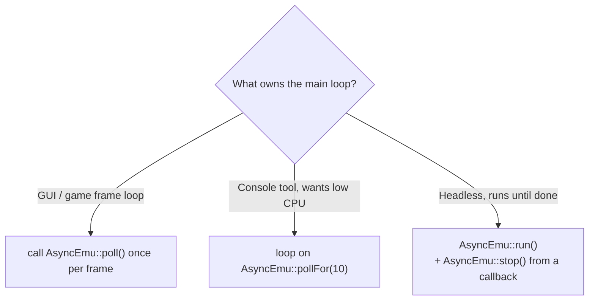

# Event Loop

Declared in `include/AsyncEmu.h`, implemented in `src/loop.cpp`.

| Function | Behaviour |
|----------|-----------|
| `std::size_t poll()` | Run all ready handlers without blocking. Returns how many ran. The primary "pump" entry point. |
| `std::size_t pollFor(unsigned ms)` | Like `poll()`, but waits up to `ms` for work. |
| `void run()` | Block until `stop()` is called or no work remains (headless tools). |
| `void stop()` | Make `run()` return. Safe to call from a callback. |
| `void post(std::function<void()>)` | Queue a function for the next `poll()`/`run()`. |
| `void reset()` | Drop all pending work and recreate the context (tests only). |

The loop restarts itself automatically after `stop()` or after running out of work, so you can call `poll()` forever without extra bookkeeping.

## Choosing how to drive it

## Notes

- Open sockets with a pending read (every connected client, every listening server, every bound UDP socket) count as work, so `run()` only returns on its own once those are closed. Use `stop()` for long-lived servers.
- `reset()` invalidates every live client, server and UDP object. Only use it when none exist.
