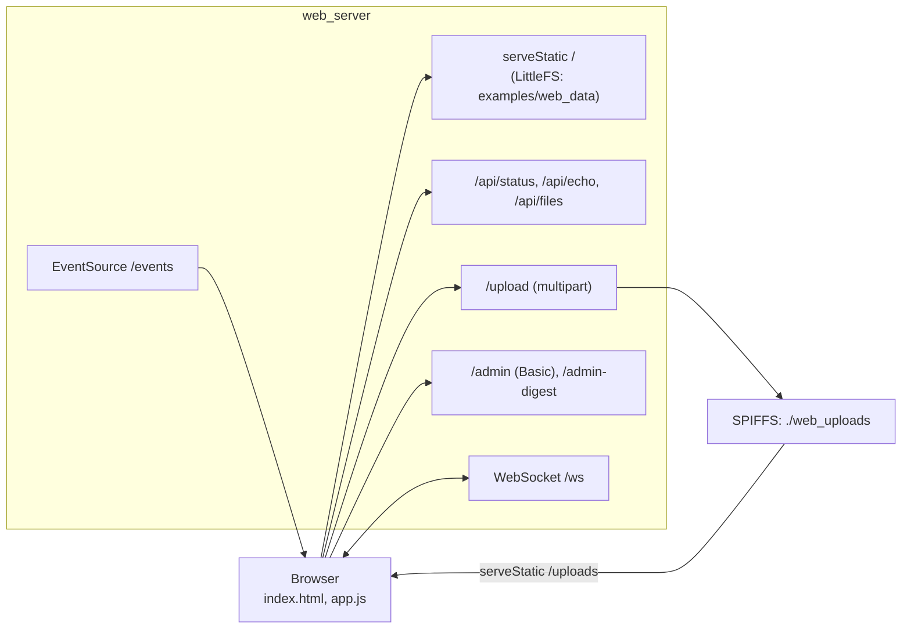
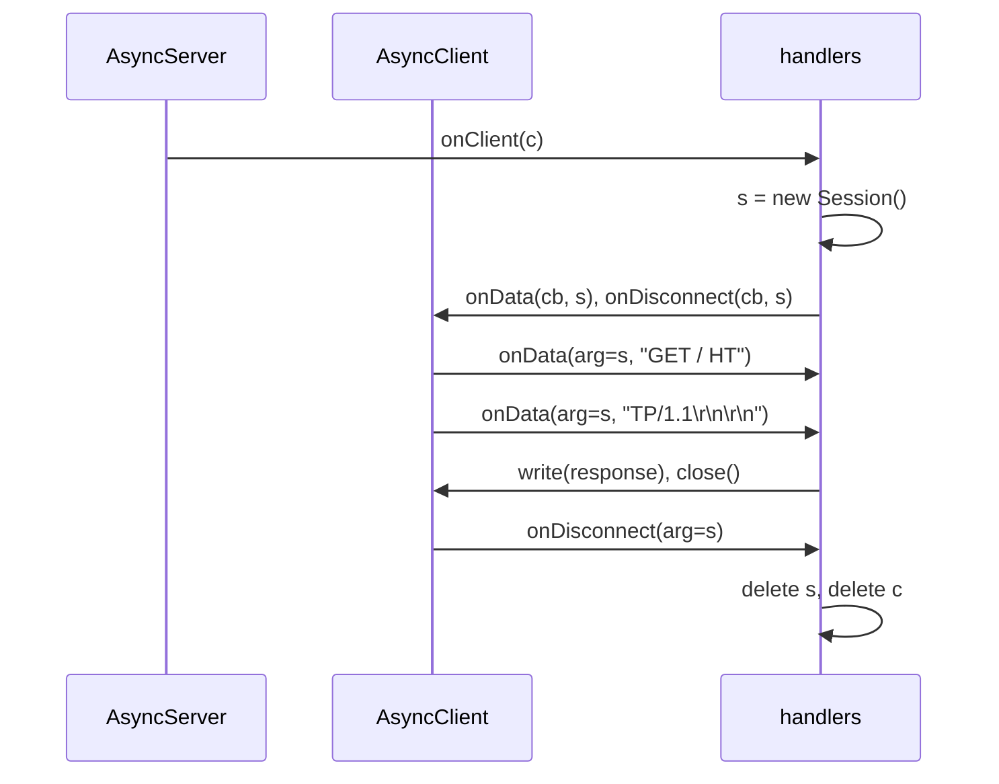

# Examples

Sources in `examples/`. Built by default when ESPAsyncEmu is the top-level project (option `ESPASYNCEMU_BUILD_EXAMPLES`); binaries land in `build/examples/`.

| Example | Kind | What it shows |
|---------|------|---------------|
| `tcp_echo_server [port]` | long-running | `AsyncServer` + per-client `onData`/`onDisconnect`, `delete c` ownership, rx timeout. Default port 7007 |
| `http_hello_server [port]` | long-running | A tiny HTTP/1.0 server on raw `AsyncServer`: per-connection state via the `arg` pointer, graceful `close()` after `write()`. Default port 8080. Preview of what the future web server layer will wrap |
| `web_server [port] [site-dir]` | long-running | A full web app on `AsyncWebServer`: static site with a browser front end (`examples/web_data`), JSON API, form POST, multipart upload to a file system, Basic and Digest auth, WebSocket chat, Server-Sent Events. Default port 8080 |
| `tcp_client_demo` | self-contained, ctest | Server and client in one process over loopback, one poll loop |
| `udp_ping_pong` | self-contained, ctest | `AsyncUDP` request/response using `packet.print()` to reply |

## Try them

```sh
./build/examples/tcp_echo_server 7007      # then in another terminal:
nc 127.0.0.1 7007

./build/examples/http_hello_server 8080    # then:
curl -i http://127.0.0.1:8080/
curl -i http://127.0.0.1:8080/missing      # 404
```

## The web app

```sh
./build/examples/web_server 8080     # then open http://127.0.0.1:8080/
```



- The start page is sent with a template processor (`%HOST%`); everything else is served as plain cacheable files (ETag, 304).
- Uploads stream to `./web_uploads/uploads/` chunk by chunk through `request->_tempObject`; the filename's directory part is stripped.
- A tick event is pushed to all SSE clients once a second from the main loop, which is how the page's uptime counter updates.
- Credentials for the protected pages: `admin` / `secret`.

Try the API from a terminal:

```sh
curl http://127.0.0.1:8080/api/status
curl -d "name=Ada&color=blue" http://127.0.0.1:8080/api/echo
curl -F "file=@photo.jpg" http://127.0.0.1:8080/upload
curl -u admin:secret http://127.0.0.1:8080/admin
curl --digest -u admin:secret http://127.0.0.1:8080/admin-digest
curl -N -H "Accept: text/event-stream" http://127.0.0.1:8080/events
```

## Pattern: per-connection state

Handlers take a `void* arg`. Allocate state when the client connects, pass it as `arg` to every handler, and free it in `onDisconnect`. This is how `http_hello_server` buffers a request across several `onData` calls:



## Pattern: self-contained demos

`tcp_client_demo` and `udp_ping_pong` run both ends in one process, so they need no ports or setup and can run in CI. They use port `0` (`AsyncServer(0)`, `AsyncUDP::listen(0)`) and read the real port back with `port()` / `localPort()`.
