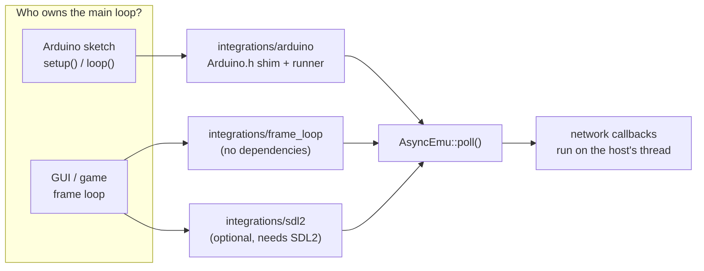
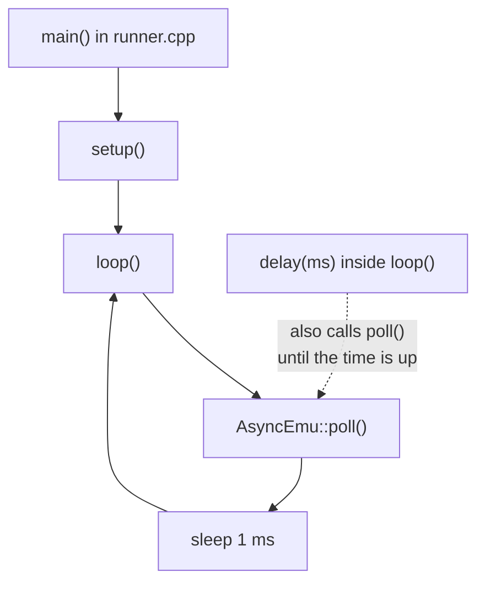
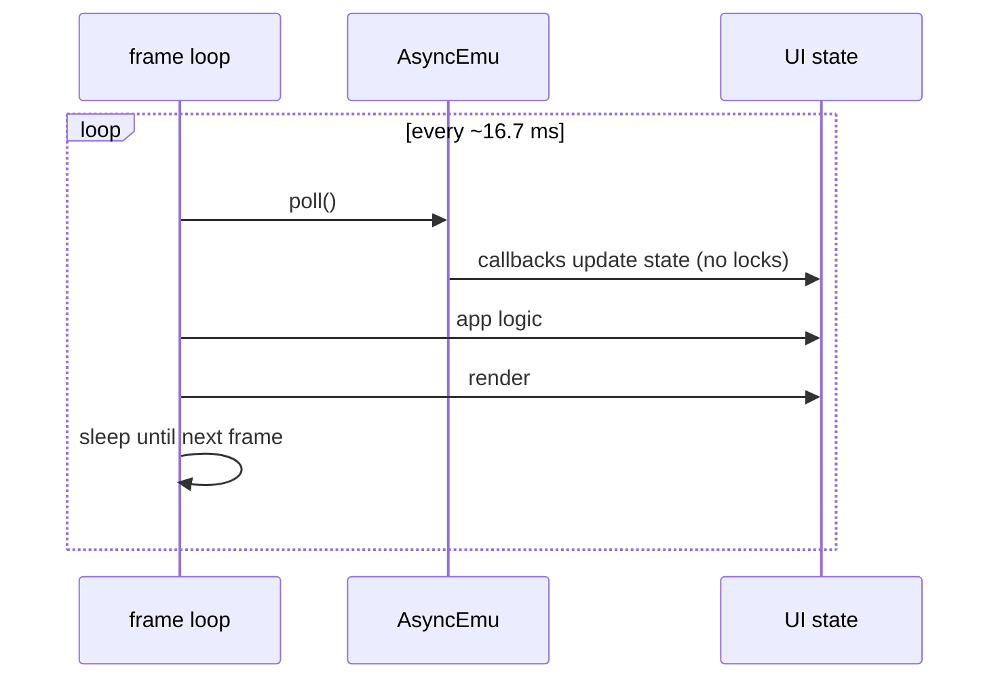

# Integrations

Ways to host the emulation inside something that already owns the main loop. Sources in `integrations/`.



The rule is the same everywhere: **call `AsyncEmu::poll()` regularly from the host's own loop.** Callbacks then run on that thread, so they can touch UI or sketch state directly with no locking.

## Arduino sketch runner (`integrations/arduino`)

Lets an Arduino-style sketch (`setup()` / `loop()`) run on the desktop.

- **`include/Arduino.h`**: minimal shim: `millis()`, `micros()`, `delay()`, `yield()`, a `Serial` object that prints to stdout (`print`, `println`, `printf`), GPIO stubs and `ESP.getFreeHeap()`. Together with `WiFi.h`, `ESP8266WiFi.h`, `AsyncTCP.h`, `LittleFS.h` and `SPIFFS.h` this lets sketches written for a real board compile unchanged; see [Arduino-Compat](Arduino-Compat.md).
- **`runner.cpp`**: provides `main()`: runs `setup()` once, then `loop()` followed by `AsyncEmu::poll()` forever. `--run-for <ms>` makes it exit cleanly (used by the smoke tests); `--port-offset <n>` shifts listening ports below 1024 (so `AsyncWebServer server(80)` listens on 8080 with `--port-offset 8000`).
- **`espasyncemu_add_sketch(target sketch.cpp ...)`**: CMake helper that links a sketch with the shim and runner.



`delay()` pumping the network mirrors the real ESP, where `delay()` and `yield()` let the TCP/IP stack and async callbacks run. Sketches that block in `delay()` still serve connections.

The included `sketches/echo_sketch.cpp` serves TCP and UDP echo on port 7007 and prints a status line every 5 seconds:

```sh
./build/integrations/arduino/echo_sketch
printf hi | nc -w1 127.0.0.1 7007          # TCP
printf hi | nc -u -w1 127.0.0.1 7007       # UDP
```

### Web sketch

`sketches/web_sketch.cpp` is written the way a real ESP8266/ESP32 sketch would be: `WiFi.begin()`, an `AsyncWebServer server(80)`, a PROGMEM page with `%PLACEHOLDER%` templating, routes with query parameters, a WebSocket and Server-Sent Events, `server.onNotFound(...)`, all driven from `setup()` / `loop()`.

```sh
./build/integrations/arduino/web_sketch --port-offset 8000     # server(80) -> http://127.0.0.1:8080/
```

Not provided: GPIO behaviour beyond logging, `WiFiClient` networking, `Ticker`, etc. Add what a sketch needs to `Arduino.h`.

## Frame loop (`integrations/frame_loop`)

Dependency-free demonstration of the GUI/game pattern: a fixed ~60 fps loop that calls `poll()` exactly once per frame, then does app logic and "rendering". It echoes messages over loopback and reports statistics; it doubles as a smoke test (`frame_loop 60`).



`poll()` never blocks, so frame time is not affected by the network. Callback work does count against the frame, so keep handlers short.

## SDL2 (`integrations/sdl2`)

Optional: built only if CMake finds SDL2 (a status line says whether it was). `sdl_demo` opens a window and runs a TCP+UDP echo server on port 7007 with a visual indicator of activity: green squares for connected clients, a blue bar for recent TCP bytes, and an orange flash for UDP packets. `poll()` is called once per frame; vsync paces the loop.

```sh
./build/integrations/sdl2/sdl_demo
nc 127.0.0.1 7007                           # a square appears
echo hi | nc -u -w1 127.0.0.1 7007          # the bottom bar flashes
```

> Status: compiles and links; the window itself has not been exercised in automated tests (no display in CI).

The same pattern applies to Dear ImGui, Qt (call `poll()` from a `QTimer`), or any toolkit with an idle/frame hook.
