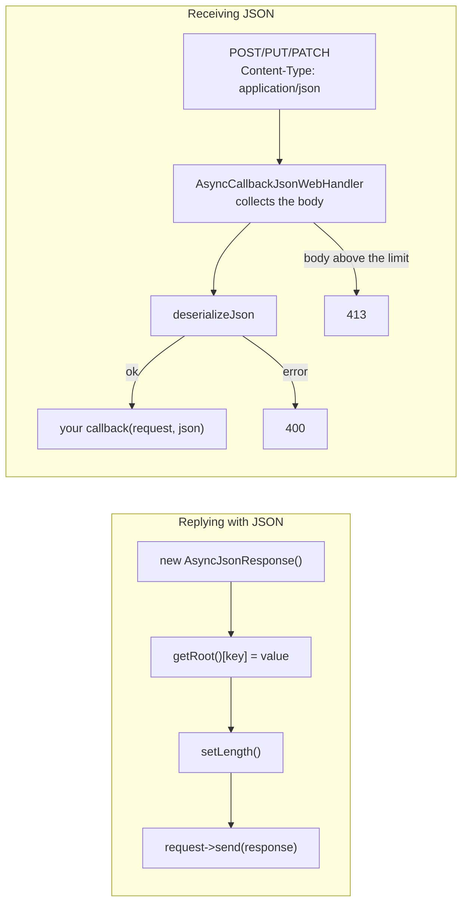

# JSON (AsyncJson)

`include/AsyncJson.h` (header only). The same classes as the real ESPAsyncWebServer's `AsyncJson.h`, on top of [ArduinoJson](https://arduinojson.org). CMake fetches ArduinoJson automatically:

| CMake option | Meaning |
|--------------|---------|
| `ESPASYNCEMU_ENABLE_JSON` (default ON) | fetch ArduinoJson and define `ESPASYNCEMU_HAS_ARDUINOJSON` |
| `ESPASYNCEMU_ARDUINOJSON_TAG` (default `v7.4.3`) | which ArduinoJson to fetch; **v6.21.x and v7.x** both work |
| `FETCHCONTENT_SOURCE_DIR_ARDUINOJSON` | use a local checkout (offline builds) |



## Responses

```cpp
#include "AsyncJson.h"

server.on("/status", HTTP_GET, [](AsyncWebServerRequest* request) {
    AsyncJsonResponse* response = new AsyncJsonResponse();   // object root; AsyncJsonResponse(true) for an array
    JsonVariant& root = response->getRoot();
    root["uptime"] = millis();
    root["name"] = request->arg("name");                     // an Arduino String goes straight in
    response->setLength();                                   // required, see below
    request->send(response);
});
```

| Class | Output |
|-------|--------|
| `AsyncJsonResponse` | compact JSON, `Content-Type: application/json`, `Content-Length` known |
| `PrettyAsyncJsonResponse` | indented JSON |
| `AsyncMessagePackResponse` | MessagePack, `Content-Type: application/x-msgpack` |

- `setLength()` serializes the document and fixes the `Content-Length`. If you forget it the response is invalid and the server answers **500**, exactly like the real library. Changing the document after `setLength()` has no effect.
- With ArduinoJson **v6** a document has a fixed capacity, set by the second constructor argument (`new AsyncJsonResponse(false, 4096)`, default 1024), as on the device. With **v7** documents grow on demand and the argument is ignored.
- The other common pattern works too, because `AsyncResponseStream` is a `Print`: `AsyncResponseStream* s = request->beginResponseStream("application/json"); serializeJson(doc, *s); request->send(s);`. That response uses chunked encoding.

## Requests

```cpp
server.addHandler(new AsyncCallbackJsonWebHandler("/api/set", [](AsyncWebServerRequest* request, JsonVariant& json) {
    int level = json["level"] | 5;                 // default when missing
    request->send(200, "application/json", "{\"level\":" + String(level) + "}");
}));
```

| Behaviour | Details |
|-----------|---------|
| Methods | `POST`, `PUT`, `PATCH` by default; `setMethod(HTTP_POST)` to change |
| Content-Type | only requests with `application/json` (a `; charset=utf-8` suffix is fine) reach the handler; others fall through to the next handler or the 404 |
| Body limit | `setMaxContentLength(n)`, default **16384** bytes. A larger `Content-Length` is answered with **413** as soon as the body starts arriving; it is never buffered |
| Bad input | malformed JSON, or an empty body: **400** |
| URL | matches the URI exactly or as a prefix followed by `/` |
| Ownership | like every `addHandler()` object it is **not** owned by the server (it leaks at exit if allocated with `new`, which is harmless) |

The body is collected in `request->_tempObject` (freed with the request), then parsed once complete. v6 documents are sized `max(configured size, 8 x body length)`: slightly more generous than the device, because host slots are larger.

## Arduino types with ArduinoJson

ArduinoJson reads and writes the emulated Arduino types:

| You write | Works because |
|-----------|---------------|
| `doc["k"] = someString;` `deserializeJson(doc, someString);` | `String` is a `std::string`; ArduinoJson recognises it by duck typing |
| `String out; serializeJson(doc, out);` | `String::append()` returns `String&`, which ArduinoJson needs to treat it as a string destination |
| `serializeJson(doc, file);` | `File` is a `Stream`/`Print` |
| `deserializeJson(doc, file);` | `File` is a `Stream` |
| `serializeJson(doc, *responseStream);` `serializeJson(doc, Serial);` | `AsyncResponseStream` and `Serial` are `Print`s |

CMake defines `ARDUINOJSON_ENABLE_ARDUINO_STREAM` and `ARDUINOJSON_ENABLE_ARDUINO_PRINT` for you. `ARDUINOJSON_ENABLE_ARDUINO_STRING` is deliberately **not** set: it would make ArduinoJson's string reader ambiguous for a class that is both a `std::string` and an Arduino `String`. See [Arduino-Compat](Arduino-Compat.md).

## Differences from the device library

- `ChunkPrint` is not provided (an implementation detail); the response serializes once in `setLength()` instead of re-serializing for each chunk.
- `AsyncCallbackJsonWebHandler` keeps per-request state in the request, not in the handler, so concurrent requests are safe.
- `AsyncMessagePackResponse` exists but there is no MessagePack request handler.

Tests: `tests/json_test.cpp`, run against both ArduinoJson v7.4.3 and v6.21.6 during development, and under the esp8266 and esp32 [device profiles](Device-Profiles.md).
