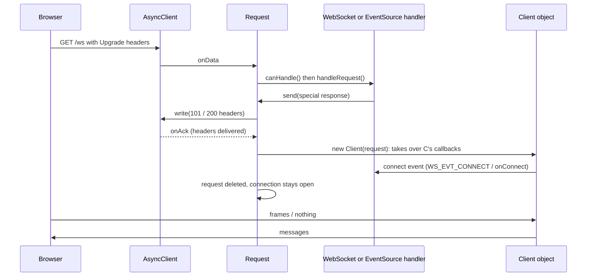
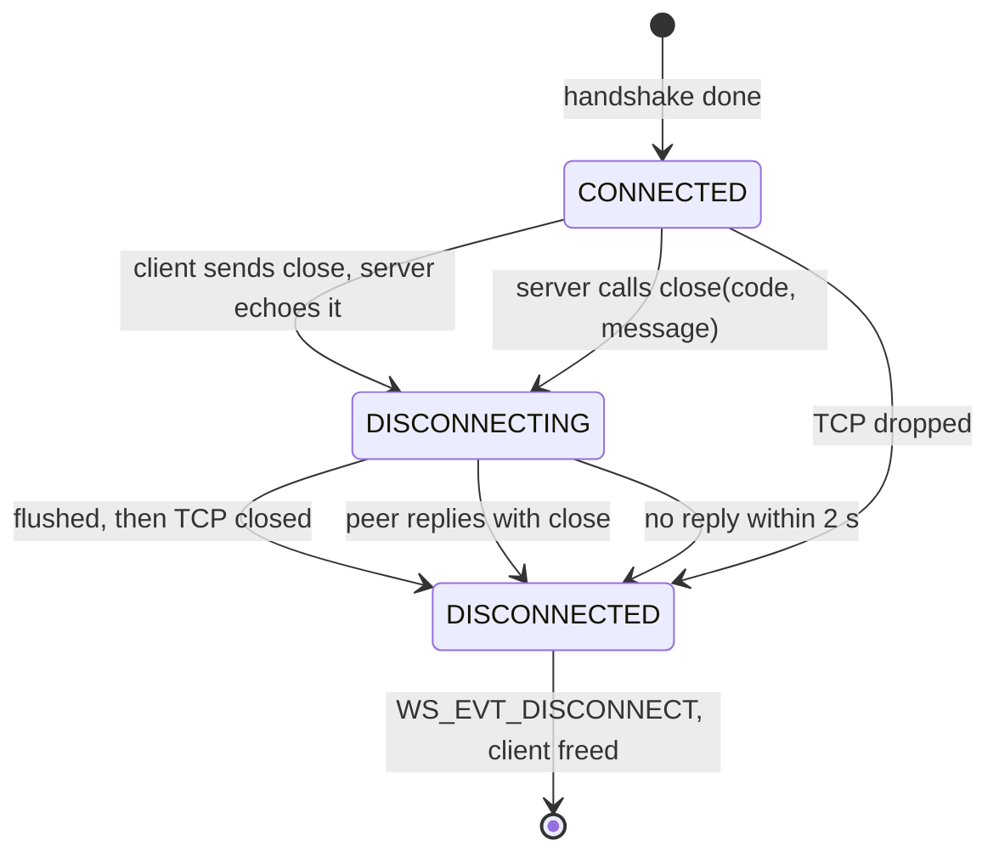

# Realtime: WebSocket and Server-Sent Events

`include/AsyncWebSocket.h` / `src/AsyncWebSocket.cpp` and `include/AsyncEventSource.h` / `src/AsyncEventSource.cpp`. Both are *handlers* you add to an [AsyncWebServer](ESPAsyncWebServer.md) with `server.addHandler(&obj)`, and both follow the real ESPAsyncWebServer API.

## From HTTP request to long-lived connection

A WebSocket or event-stream starts as an ordinary request. The handler sends a special response; when its headers have been acknowledged, a client object takes over the TCP connection and the request is released:



The connection is no longer subject to the request idle timeout.

## WebSocket

```cpp
AsyncWebSocket ws("/ws");

ws.onEvent([](AsyncWebSocket* server, AsyncWebSocketClient* client, AwsEventType type, void* arg, uint8_t* data, size_t len) {
    if (type == WS_EVT_DATA) {
        auto* info = static_cast<AwsFrameInfo*>(arg);
        if (info->final && info->index == 0 && info->len == len && info->opcode == WS_TEXT)
            server->textAll(String(reinterpret_cast<char*>(data), len));   // a whole text message
    }
});
server.addHandler(&ws);
```

### Handshake

A request is handled when it is a `GET` to the exact URL with `Upgrade: websocket`. The handler answers:

| Condition | Response |
|-----------|----------|
| `Sec-WebSocket-Version` missing or not 13 | `400` + `Sec-WebSocket-Version: 13` |
| `Sec-WebSocket-Key` missing | `400` |
| credentials set and missing/wrong | `401` (`ws.setAuthentication(user, pass)`) |
| otherwise | `101 Switching Protocols`, `Upgrade: websocket`, `Connection: Upgrade`, `Sec-WebSocket-Accept: base64(sha1(key + GUID))`; an offered `Sec-WebSocket-Protocol` is echoed |

Verified with the RFC 6455 example key and an independent Python client.

### Events

| `AwsEventType` | `arg` | `data`, `len` |
|----------------|-------|---------------|
| `WS_EVT_CONNECT` | the upgrade `AsyncWebServerRequest*` (valid only during the callback) | none |
| `WS_EVT_DISCONNECT` | none | none |
| `WS_EVT_DATA` | `AwsFrameInfo*` | a chunk of the frame payload, unmasked |
| `WS_EVT_PONG` | none | the pong payload |
| `WS_EVT_ERROR` | pointer to the TCP error code | none |

`AwsFrameInfo` describes the frame the chunk belongs to:

| Field | Meaning |
|-------|---------|
| `opcode` | opcode of this frame (`WS_TEXT`, `WS_BINARY`, `WS_CONTINUATION`) |
| `message_opcode` | opcode of the first frame of the message |
| `num` | frame number within the message (0 for the first) |
| `final` | FIN bit of this frame |
| `len` | payload length of the whole frame |
| `index` | offset of this chunk inside the frame payload |

A frame can arrive in several chunks (large frames, or TCP segmentation), each delivered as its own `WS_EVT_DATA` with growing `index`. A message is complete when `final` is set and `index + len == info->len`. An empty frame produces one event with `len == 0`.

### Sending

`client->text(...)`, `client->binary(...)`, `client->printf(...)`, `ws.text(id, ...)`, `ws.textAll(...)`, `ws.binaryAll(...)`, `ws.printfAll(...)`, `ws.makeBuffer(...)` (a buffer passed to a send call is owned by the server). Server frames are never masked; payloads of any size are encoded with the 7-, 16- or 64-bit length forms.

Each client has a queue of at most **32** messages (`WS_MAX_QUEUED_MESSAGES`). Messages are written as the TCP send buffer drains; if the queue is full a new message is **dropped** (`client->queueIsFull()`, `canSend()`), as on the device. Control frames (pong, ping, close) jump ahead of queued data but never split a frame already partly sent.

### Control frames and closing

- A **ping** from the client is answered with a pong carrying the same payload. `ws.pingAll()` / `client->ping()` send pings; the reply arrives as `WS_EVT_PONG`.
- `client->keepAlivePeriod(seconds)` makes the server ping an idle client (checked every ~500 ms).
- `ws.cleanupClients(max)` closes the oldest client when there are more than `max` (default 4).



`WS_EVT_DISCONNECT` is delivered once, whichever way the connection ends. `ws.count()` only counts clients that haven't been freed yet.

### What is not checked

No `permessage-deflate`, no UTF-8 validation of text frames, and the server does not enforce that client frames are masked or that reserved bits are zero.

## Server-Sent Events

```cpp
AsyncEventSource events("/events");
events.onConnect([](AsyncEventSourceClient* client) { client->send("hello", nullptr, 1, 3000); });
server.addHandler(&events);
...
events.send("21.5", "temperature", /*id=*/42);   // to everyone
```

- A request is an event stream when it is a `GET` to the URL with `Accept: text/event-stream`. Without that header it is an ordinary request (and normally a 404).
- The response is `200`, `Content-Type: text/event-stream`, `Cache-Control: no-cache`, `Connection: keep-alive`, no length.
- `events.authorizeConnect(fn)` can reject a connection (a `401` is sent); `events.setAuthentication(...)` uses Basic auth.
- `client->lastId()` is the `Last-Event-ID` header the browser sent when reconnecting.

Message format (multi-line messages become several `data:` lines):

```
retry: 3000        <- only if reconnect != 0
id: 5              <- only if id != 0
event: update      <- only if an event name is given
data: line one
data: line two

```

Like the WebSocket, each SSE client has a queue of at most 32 messages (`SSE_MAX_QUEUED_MESSAGES`), and `events.send()` skips clients whose connection is gone. `events.count()` and `events.avgPacketsWaiting()` report load. There is no automatic keep-alive comment line.

## Lifetime

Neither `AsyncWebSocket` nor `AsyncEventSource` is owned by the server. When one is destroyed it closes all of its connections (without invoking user callbacks). Destroying the `AsyncWebServer` first is fine: after the hand-over the connections belong to the handler, not to the server.

Tests: `tests/realtime_test.cpp` (see [Testing](Testing.md)).
