# Roadmap

```mermaid
flowchart LR
    p1["Phase 1<br/>Event loop"]:::done --> p2["Phase 2<br/>ESPAsyncTCP"]:::done
    p2 --> p3["Phase 3<br/>ESPAsyncUDP"]:::done
    p3 --> p4["Phase 4<br/>Examples + integrations"]:::done
    p4 --> p5["Phase 5<br/>ESPAsyncWebServer layer"]:::done
    p5 --> p6["Phase 6<br/>AsyncJson + device limits"]:::done
    p6 --> p7["Phase 7<br/>Polish and extras"]:::next
    classDef done fill:#cfe8cf,stroke:#4a8a4a,color:#000
    classDef next fill:#fff1c2,stroke:#b8920a,color:#000
    classDef later fill:#e6e6e6,stroke:#888,color:#000
```

## Done

- Event loop: `poll`, `pollFor`, `run`, `stop`, `post`, `reset`, port offset
- `AsyncClient` / `AsyncServer` (ESPAsyncTCP)
- `AsyncUDP` / `AsyncUDPPacket` / `AsyncUDPMessage` (ESPAsyncUDP)
- [ESPAsyncWebServer](ESPAsyncWebServer.md): routing (exact, wildcard, regex), request parsing, params, urlencoded and multipart bodies with streamed uploads, response types (basic, file, chunked, stream, callback, progmem), template processing, static files with ETag/304/gzip, Basic and Digest auth, rewrites, filters, default headers
- [Realtime](Realtime.md): `AsyncWebSocket` (RFC 6455) and `AsyncEventSource` (SSE)
- [Arduino-Compat](Arduino-Compat.md): `String`, sandboxed `FS`/`LittleFS`/`SPIFFS`, `IPAddress`
- [Examples](Examples.md): echo server, HTTP servers, full web app with a browser front end, self-contained demos
- [Integrations](Integrations.md): Arduino sketch runner with `Arduino.h`/`WiFi.h` shims and an echo and a web sketch, frame-loop demo, optional SDL2 demo
- Tests for everything, clean under ASan/UBSan; web layer cross-checked with curl, curl `--digest` and an independent Python WebSocket client
- [Json](Json.md): `AsyncJsonResponse`, `PrettyAsyncJsonResponse`, `AsyncMessagePackResponse`, `AsyncCallbackJsonWebHandler` on ArduinoJson v6 and v7; `Print` / `Stream` / `Printable` so `serializeJson(doc, ...)` works with responses, files and Serial
- [Device-Profiles](Device-Profiles.md): esp8266 / esp8266-hb / esp32 limits (send buffer, connection cap, strict headers, form body limit, watchdog, `delay()` in callbacks) with warnings; the web, realtime and JSON suites run under every profile
- Markdown wiki with an HTML build

## Next

- `Transfer-Encoding: chunked` request bodies
- A heap budget (`ESP.getFreeHeap()` that shrinks with queued messages, buffered bodies and response buffers)
- MessagePack request handler
- Grow the `Arduino.h` shim as sketches need it (`WiFiClient`, `Ticker`, ...)
- Verify the SDL2 demo visually / add an ImGui integration

## Later

- Optional: IPv6, `isBroadcast()` support (needs `recvmsg` with packet info), TLS

## Known limitations

See the "Differences" and "Limitations" sections of [ESPAsyncTCP](ESPAsyncTCP.md) and [ESPAsyncUDP](ESPAsyncUDP.md). Not yet verified: lwip error code numbering against real headers. The web layer's deviations are listed in [ESPAsyncWebServer](ESPAsyncWebServer.md#differences-from-the-device-library).
