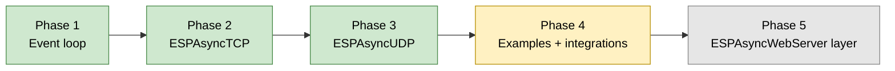

# Roadmap

## Done

- Event loop: `poll`, `pollFor`, `run`, `stop`, `post`, `reset`
- `AsyncClient` / `AsyncServer` (ESPAsyncTCP)
- `AsyncUDP` / `AsyncUDPPacket` / `AsyncUDPMessage` (ESPAsyncUDP)
- `IPAddress`
- Tests for all of the above, clean under ASan/UBSan

## Next

- `examples/`: TCP echo server, UDP ping/pong
- `integrations/`: hooking `poll()` into a GUI frame loop (SDL / ImGui)
- Wiki: keep pages in sync as features land

## Later

- ESPAsyncWebServer-style layer on top of `AsyncServer`
- Optional: IPv6, `isBroadcast()` support (needs `recvmsg` with packet info)

## Known limitations

See the "Differences" and "Limitations" sections of [ESPAsyncTCP](ESPAsyncTCP.md) and [ESPAsyncUDP](ESPAsyncUDP.md). Not yet verified: lwip error code numbering against real headers.
