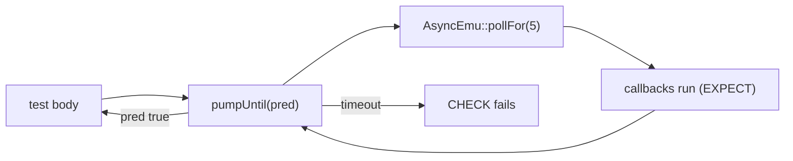

# Testing

## Build and run

```sh
cmake -S . -B build
cmake --build build -j
cd build && ctest --output-on-failure
```

Tests are built when ESPAsyncEmu is the top-level CMake project (option `ESPASYNCEMU_BUILD_TESTS`).

## Suites

| Test | File | Covers |
|------|------|--------|
| `loop_test` | `tests/loop_test.cpp` | `poll`, `post`, `run`/`stop`, reuse after stop |
| `tcp_test` | `tests/tcp_test.cpp` | echo over loopback, `space()`/`onAck`, 100 KB transfer, graceful close, reconnect via `"localhost"`, `abort()`, connection refused, rx timeout (~1 s), deleting clients inside callbacks |
| `udp_test` | `tests/udp_test.cpp` | `listen` + `writeTo`, reply via packet, `onPacket` with arg, `connect` + `AsyncUDPMessage`, `close`, deleting inside callback |
| `web_test` | `tests/web_test.cpp` | routing (methods, wildcard, prefix, regex), params, headers, urlencoded and raw bodies, `100-continue`, multipart (100 KB, 3-byte pieces, partial boundaries), chunked / known-length / streamed / templated responses, static files (default file, gzip, ETag, 304, traversal), Basic and Digest auth, rewrites, deferred responses, malformed requests, idle timeout, server teardown |
| `realtime_test` | `tests/realtime_test.cpp` | WebSocket handshake (RFC example key), text/binary/fragmented frames, 64-bit lengths, ping/pong, broadcast, both close handshakes, queue limit, keep-alive; SSE formatting, `Last-Event-ID`, authorize; teardown with live clients |
| `compat_test` | `tests/compat_test.cpp` | `String` API and numeric `+`, `Print` / `Stream` / `Printable`, `FS`/`File`, directory iteration, sandbox against `..` |
| `json_test` | `tests/json_test.cpp` | JSON / pretty / MessagePack responses, `AsyncCallbackJsonWebHandler` (methods, content type, 400, 413, split bodies), ArduinoJson with `String`, `File`, `AsyncResponseStream` |
| `limits_test` | `tests/limits_test.cpp` | profiles, send buffer size, connection cap, watchdog and `inCallback`, strict headers (custom handlers), form body limit, queue-overflow warnings |
| `*_esp8266`, `*_esp8266-hb`, `*_esp32` | the web, realtime and JSON suites | the same suites re-run under each [device profile](Device-Profiles.md) via `ESPASYNCEMU_PROFILE` |
| `example_tcp_client_demo` | `examples/` | end-to-end TCP round trip |
| `example_udp_ping_pong` | `examples/` | end-to-end UDP round trip |
| `integration_frame_loop` | `integrations/frame_loop` | poll-per-frame loop for 60 frames, echoes received |
| `sketch_echo_runs` | `integrations/arduino` | sketch runner starts, serves, and exits cleanly (`--run-for 300`) |
| `sketch_web_runs` | `integrations/arduino` | the web sketch starts with `--port-offset` and exits cleanly |

The long-running examples (`tcp_echo_server`, `http_hello_server`, `web_server`) and the web sketch are checked by hand with `nc` and `curl` (see [Examples](Examples.md)).

## ArduinoJson versions

`AsyncJson.h` supports ArduinoJson v6 and v7. The default build uses v7.4.3. To run the JSON tests against v6:

```sh
cmake -S . -B build-v6 -DESPASYNCEMU_ARDUINOJSON_TAG=v6.21.6
cmake --build build-v6 -j --target json_test && ./build-v6/tests/json_test
```

## Independent cross-checks

The automated web tests use a test client written for this project, which can share misunderstandings with the server. The web layer was therefore also exercised with independent implementations:

- `curl` for GET/POST, multipart uploads of 300 KB and 1.5 MB (byte-identical when downloaded again), `Expect: 100-continue`, Basic auth, `If-None-Match` / 304, path traversal attempts, SSE
- `curl --digest` for Digest authentication
- a small stdlib-only Python WebSocket client (handshake with a random key, masked text frame, ping, close) against the example servers

## Helpers (`tests/test_util.h`)

- `pumpUntil(pred, timeoutMs)`: pumps `AsyncEmu::pollFor(5)` until the predicate is true. Use this instead of `sleep`.
- `ws_test_util.h`: a masking WebSocket test client (handshake, frames, close).
- `http_test_util.h`: `httpExchange()` / `httpGet()` send a raw request through an `AsyncClient` and return a parsed `HttpResponse` (status, headers, chunk-decoded body); pieces can be sent separately to exercise segmented requests.
- `CHECK(cond)`: aborts the test (`return 1`) in `main`.
- `EXPECT(cond)`: records a failure without returning; use it inside callbacks. Every test ends with `CHECK(!testFailed())`.



## Sanitizers

The delete-inside-callback paths are the risky ones, so run the suite under ASan/UBSan after touching lifetime code:

```sh
cmake -S . -B build-asan -DCMAKE_CXX_FLAGS="-fsanitize=address,undefined -g"
cmake --build build-asan -j && (cd build-asan && ctest --output-on-failure)
```

Tests use loopback and ephemeral ports (`AsyncServer(0)`, `AsyncUDP::listen(0)`), so they can run in parallel with other software.
