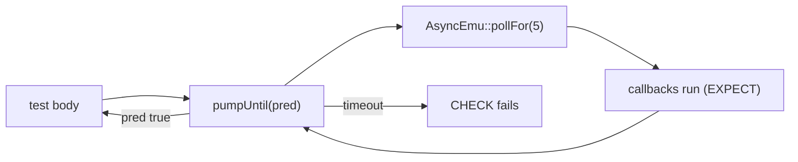

# Testing

## Build and run

```sh
cmake -S . -B build
cmake --build build -j
cd build && ctest --output-on-failure
```

Tests are built when ESPAsyncEmu is the top-level CMake project (option `ESPASYNCEMU_BUILD_TESTS`).

## Suites

| Test | File | Covers |
|------|------|--------|
| `loop_test` | `tests/loop_test.cpp` | `poll`, `post`, `run`/`stop`, reuse after stop |
| `tcp_test` | `tests/tcp_test.cpp` | echo over loopback, `space()`/`onAck`, 100 KB transfer, graceful close, reconnect via `"localhost"`, `abort()`, connection refused, rx timeout (~1 s), deleting clients inside callbacks |
| `udp_test` | `tests/udp_test.cpp` | `listen` + `writeTo`, reply via packet, `onPacket` with arg, `connect` + `AsyncUDPMessage`, `close`, deleting inside callback |

## Helpers (`tests/test_util.h`)

- `pumpUntil(pred, timeoutMs)`: pumps `AsyncEmu::pollFor(5)` until the predicate is true. Use this instead of `sleep`.
- `CHECK(cond)`: aborts the test (`return 1`) in `main`.
- `EXPECT(cond)`: records a failure without returning; use it inside callbacks. Every test ends with `CHECK(!testFailed())`.



## Sanitizers

The delete-inside-callback paths are the risky ones, so run the suite under ASan/UBSan after touching lifetime code:

```sh
cmake -S . -B build-asan -DCMAKE_CXX_FLAGS="-fsanitize=address,undefined -g"
cmake --build build-asan -j && (cd build-asan && ctest --output-on-failure)
```

Tests use loopback and ephemeral ports (`AsyncServer(0)`, `AsyncUDP::listen(0)`), so they can run in parallel with other software.
